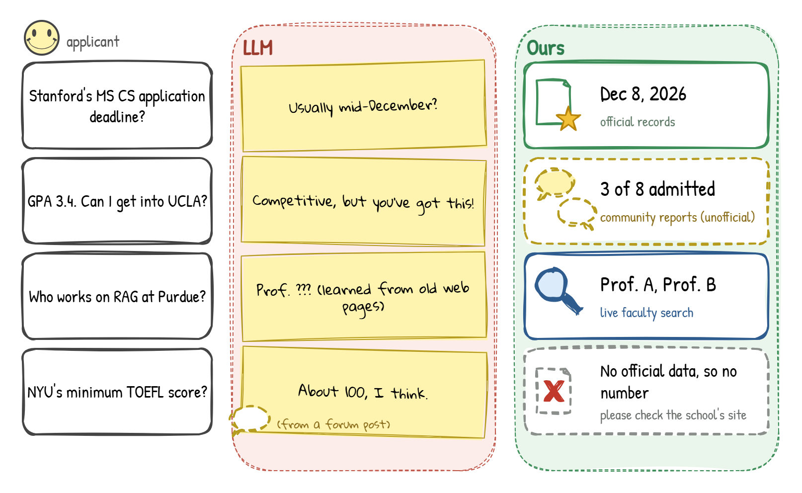

<div align="center">

# A Source-Aware Agentic RAG Architecture for Study-Abroad Admissions Advising: Design and Evaluation

**TAAI 2026 · Domestic Track · (poster presentation)**

[Po-Yuan Huang](https://github.com/iamhenryhuang)<sup>1</sup>, [Ting-Han Wu](https://github.com/112703028)<sup>1</sup>, [Kai-Ting Chen](https://github.com/ckt1022)<sup>1</sup> (equal contribution)

<sup>1</sup>Department of Computer Science, National Chengchi University

Paper (coming soon) · [Quick start](#quick-start) · [Citation](#citation)

[](#citation)
[](LICENSE)



</div>

**TL;DR.** A source-aware agentic RAG that routes study-abroad questions by source authority, not just relevance, and abstains when official evidence is missing.

## How it works

| Question about | Handled by | Treated as |
|---|---|---|
| Official requirements (deadline, TOEFL/IELTS, GRE, fees) | Text-to-SQL over structured records extracted from official pages | Official |
| Admission experiences | Retrieval over community reports | Unofficial, labeled as such |
| Faculty research | Query-time search (SerpAPI) over faculty profiles | Current, not stored |

Before answering, a bounded evidence check (the Verifier) decides whether the retrieved evidence covers the question. If not, the system retries with full-text search over the crawled pages, then with a rewritten query, and otherwise abstains. A Critic checks the generated answer and flags statements that look unsupported.

## Repository

| Directory | Contents |
|---|---|
| [`backend/`](backend/README.md) | FastAPI service, command line and the LangGraph agent: routing, text-to-SQL, full-text and hybrid retrieval, Verifier, answer generation, Critic |
| [`data_crawler/`](data_crawler/README.md) | Ingestion: crawl official pages, extract fields with their source excerpt, validate each excerpt against the page, chunk and store |
| [`db/`](db/README.md) | PostgreSQL + pgvector schema (`schema/`) and batch loaders (`loaders/`) |

## Quick start

```bash
# 1. Database (PostgreSQL + pgvector, host port 5434)
docker compose up -d db

# 2. Python environment
python -m venv .venv
source .venv/Scripts/activate      # Git Bash; use .venv/bin/activate on Linux/macOS
pip install -r requirements.txt
playwright install chromium

# 3. Configuration (fill in OPENAI_API_KEY and SERPAPI_KEY)
cp .env.example backend/.env

# 4. Empty schema (run once; init-schema drops the crawler tables)
python backend/run.py setup
python backend/run.py init-schema
python backend/run.py init-experience

# 5. Crawl a school's official pages, then check the result
python -m data_crawler.main --school-id stanford --max-depth 1 --max-pages 10
python backend/run.py verify-db
```

Ask the agent, or start the API:

```bash
python backend/run.py agent "Stanford CS MS 申請費是多少？"
uvicorn backend.api:app --reload --host 0.0.0.0 --port 8000
```

Endpoints: `POST /api/chat` (SSE agent), `GET /api/health`, `POST` and `GET /api/experiences`. The API exits with an error if it cannot reach the database, so start the database first.

A CPU is enough: the language models are called through the OpenAI API. Hybrid retrieval is optional; until you run `python -m data_crawler.backfill_embeddings` the system uses PostgreSQL full-text search and loads no embedding model.

## Models

| Role | Model | Configured by |
|---|---|---|
| Planning, verification, critique, text-to-SQL | `gpt-4o-mini` | `OPENAI_MODEL` |
| Final answer generation | `gpt-4o` | `OPENAI_ANSWER_MODEL` |
| Embeddings and reranker (optional) | `BAAI/bge-m3`, `BAAI/bge-reranker-v2-m3` | `BGE_EMBED_MODEL_PATH`, `BGE_RERANKER_MODEL_PATH` |
| Faculty lookup | SerpAPI | `SERPAPI_KEY` |

`.env.example` sets `OPENAI_MODEL=gpt-4.1`; set it to `gpt-4o-mini` to match the paper. `OPENAI_BASE_URL` can point to any compatible endpoint.

## Data

This repository contains code only. It does not redistribute crawled university text, GradCafe or 1point3acres records (or statistics derived from them), or the faculty list.

- **School information is crawled** with `data_crawler`. Mind each site's terms of use.
- **Community reports, the faculty list and school medians are collected by hand** and loaded from JSON files in `db/data/` (`python backend/run.py load-professors`, `python db/loaders/load_applicant_reports.py`). Without the community files the Experience path has nothing to retrieve.

[`db/data/README.md`](db/data/README.md) lists every file the system expects and its format.

The output is research software, not official admissions advice. Check requirements on the school's website before you apply.

## FAQ

<details>
<summary>The agent says it has no data for a school.</summary>

The database is empty until you crawl. Run `data_crawler.main --school-id <id>` (ids are in `data_crawler/config/root_url.py`). A school with no official data is answered with "not indexed", not a guess.

</details>

<details>
<summary>I cannot connect to the database.</summary>

The database is published on host port **5434**, not 5432, so `DATABASE_URL` must use `127.0.0.1:5434`. On Windows with Docker Desktop, use `127.0.0.1` rather than `localhost`.

</details>

<details>
<summary>I ran <code>init-schema</code> again and my crawled data is gone.</summary>

`init-schema` drops and recreates the crawler tables. Run it once before crawling.

</details>

<details>
<summary>Why is there still Chinese in the code?</summary>

Comments and logs are in English. The remaining Chinese is part of the behavior: the prompts, the answer text (the system answers in Traditional Chinese), and the alias and regex data that match Chinese questions. Translating it would change how the agent behaves.

</details>

## Citation

```bibtex
@inproceedings{huang2026sourceaware,
  title     = {A Source-Aware Agentic RAG Architecture for Study-Abroad Admissions Advising: Design and Evaluation},
  author    = {Huang, Po-Yuan and Wu, Ting-Han and Chen, Kai-Ting},
  booktitle = {Proceedings of the 31st International Conference on Technologies and Applications of Artificial Intelligence (TAAI)},
  year      = {2026},
  note      = {Domestic Track}
}
```

## License

Code: Apache License 2.0, see [LICENSE](LICENSE). Third-party web content and community records are not redistributed here and remain subject to the terms of their sources.

Built on [LangGraph](https://github.com/langchain-ai/langgraph), [FastAPI](https://fastapi.tiangolo.com/), [PostgreSQL](https://www.postgresql.org/) with [pgvector](https://github.com/pgvector/pgvector), [Playwright](https://playwright.dev/), [trafilatura](https://github.com/adbar/trafilatura) and [BGE](https://huggingface.co/BAAI/bge-m3). Questions and bug reports: please open an issue.
